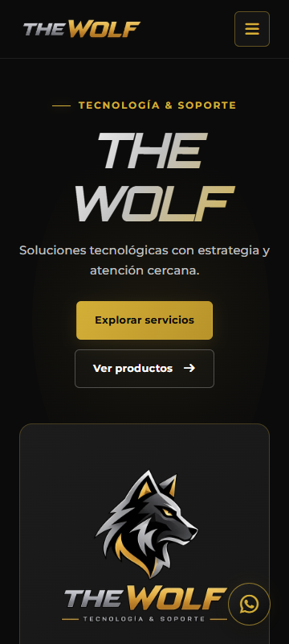
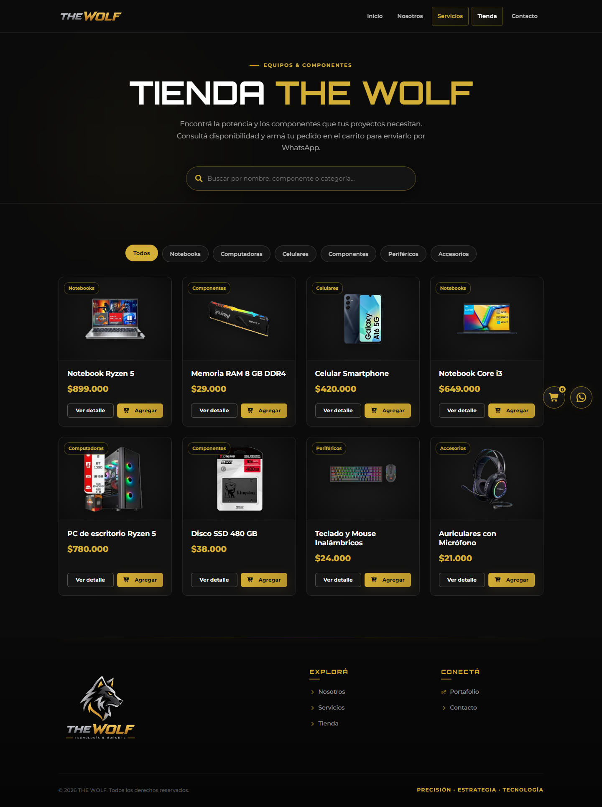
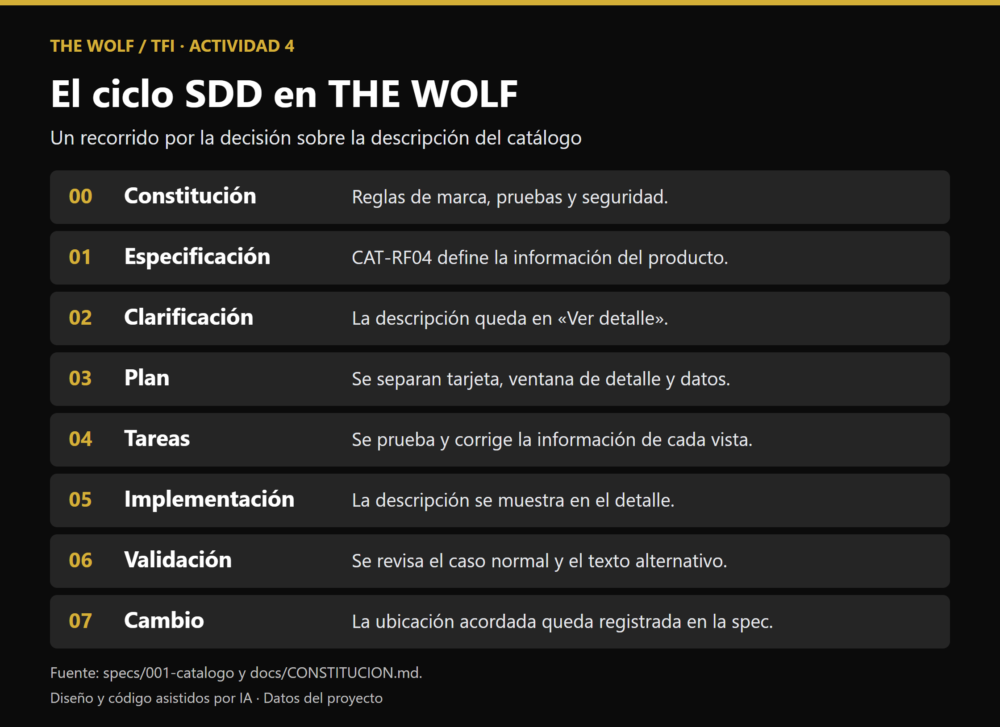
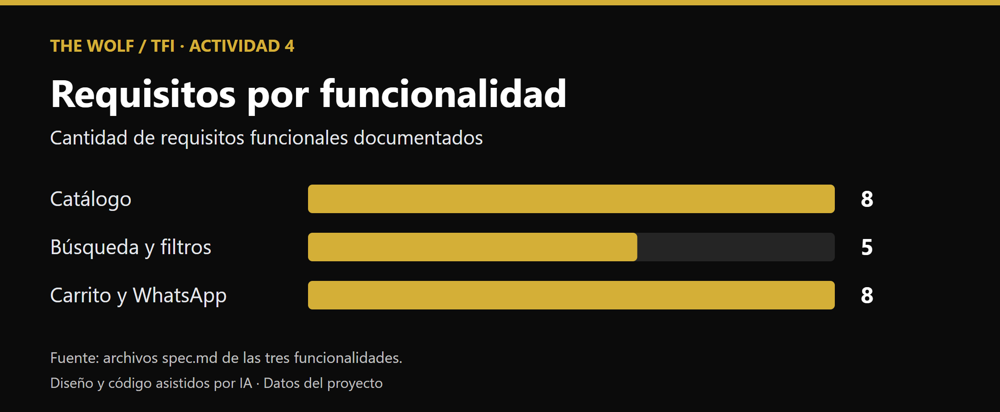
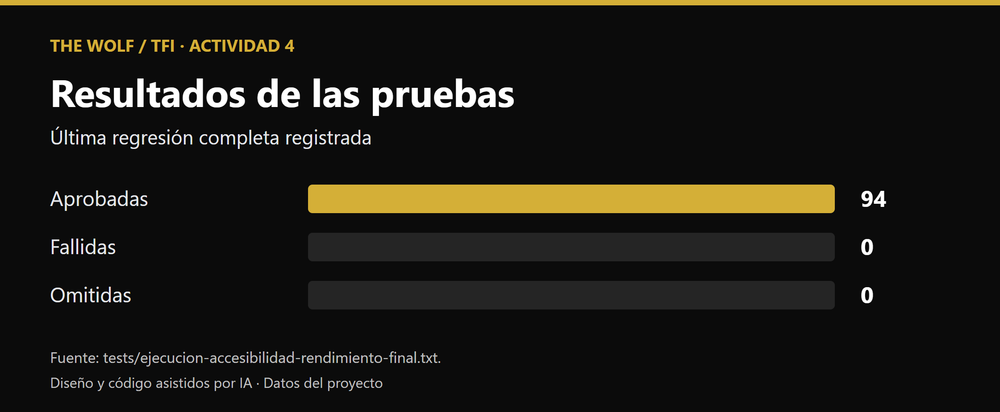
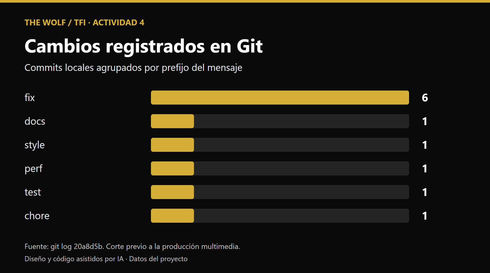

# Informe guionado · THE WOLF

## Portada e introducción

THE WOLF · Tecnología y soporte  
Estudiante: Alexis Gabriel Soria  
Institución: Instituto de Estudios Superiores de Tinogasta  
Carrera: Tecnicatura Superior en Desarrollo de Software, 3.º año  
Asignatura: Inteligencia Artificial  
Docente: Ana Camila Barrionuevo  
Fecha de entrega: pendiente.

THE WOLF reúne la oferta de productos y servicios tecnológicos en un sitio de consulta. El público puede revisar el catálogo, filtrar resultados y preparar una consulta por WhatsApp. El carrito calcula un total estimado y la disponibilidad se confirma con el emprendimiento.

## Antecedentes de la bitácora

- **TP 1.** El análisis de *I Am Mother* y *Autómata* aporta el marco ético sobre autonomía e influencia. La declaración desarrolla el caso de *I Am Mother* aplicado a la transparencia de las piezas del sitio.
- **TP 2.** El trabajo grupal sobre Claude documenta la comparación de herramientas y el rol de Alexis como Product Owner. En el TFI, Codex fue la herramienta utilizada para apoyar la documentación, el código y las pruebas. La elección se justifica por la posibilidad de trabajar sobre el repositorio y verificar los cambios localmente.
- **TP 3.** Las especificaciones Markdown de THE WOLF son el antecedente de la identidad de marca y del alcance de productos y soporte. El informe del TFI debe distinguir esa propuesta de la implementación actual del catálogo y el carrito de consulta.

## Índice de trabajo

1. Introducción y antecedentes de la bitácora
2. Desarrollo de las actividades 1 a 6
3. Conclusión
4. Referencias y anexos

Completar la paginación al exportar el informe con sus figuras definitivas.

## Desarrollo

### a. Punto de partida

El trabajo parte de la propuesta y las especificaciones de THE WOLF del TP 3. La constitución recoge reglas sobre identidad de marca, seguridad y verificación. El arnés reúne las instrucciones de AGENTS.md, la memoria de decisiones, los prompts de especificación, clarificación y verificación en .github/prompts y las skills locales de requisitos y criterios. Estos archivos permiten retomar el trabajo a partir de reglas compartidas y conservar evidencia de las decisiones.

La matriz del Anexo I registra las herramientas efectivamente usadas, el motivo de su elección y cómo se revisaron sus resultados.

### b. Ciclo SDD

| Funcionalidad | Requisitos y decisión | Evidencia |
|---|---|---|
| Catálogo | Ocho RF cubren lectura, orden, disponibilidad, datos y estados de consulta. La descripción se muestra en «Ver detalle», con texto alternativo cuando falta. | [Verificación del catálogo](../specs/001-catalogo/verificacion.md) |
| Búsqueda y filtros | Cinco RF cubren coincidencia por nombre o categoría y combinación con el filtro. Limpiar el texto conserva la categoría seleccionada. | [Verificación de búsqueda](../specs/002-busqueda-filtros/verificacion.md) |
| Carrito y WhatsApp | Ocho RF cubren cantidades, persistencia, subtotales, total y consulta. Se muestran precio unitario y subtotal, y el mensaje pide confirmar disponibilidad. | [Verificación del carrito](../specs/003-carrito-whatsapp/verificacion.md) |

Cada carpeta contiene especificación, clarificación, plan, tareas y verificación. El trabajo revisó una implementación preexistente y registró las correcciones y pruebas realizadas. El [cierre de Actividad 2](CIERRE-ACTIVIDAD-2.md) documenta las diferencias respecto a la pauta de una tarea por conversación y el historial original de commits.

En el [registro de prompts](PROMPTS.md) se pueden explicar tres casos concretos. EIA-01 corrigió un doble de DOM que devolvía el mismo elemento para todos los identificadores. EIA-02 reforzó la prueba de protocolos porque el logo de respaldo podía ocultar el resultado del validador. EIA-06 corrigió la medición de desborde al comparar con el ancho solicitado en vez de usar el ancho que ya había crecido.

### c. Producto final

THE WOLF usa HTML, CSS y JavaScript. Supabase aporta el catálogo de lectura y el carrito guarda las cantidades en el navegador. La consulta se prepara para WhatsApp con precios estimados y confirmación de disponibilidad.

La última regresión completa registrada aprobó 94 pruebas y el build. El informe local de Lighthouse conserva 68 en rendimiento para Inicio y 65 para Tienda, con 100 en accesibilidad, buenas prácticas y SEO en ambas mediciones. Se priorizó el resto de la entrega con el criterio de 80 en rendimiento pendiente. Las URL del sitio público y GitHub se incorporarán después de la publicación.

| Aspecto de la Tabla 2 | Estado y evidencia |
|---|---|
| Publicación | Pendiente URL pública y repositorio público. |
| Requisitos, pruebas y build | Matrices en specs/. Regresión completa en tests/ejecucion-accesibilidad-rendimiento-final.txt. |
| Marca y diseño | Paleta y tipografías aplicadas mediante tokens CSS. |
| Adaptación y accesibilidad | Pruebas a 360 px, textos alternativos y recorridos de teclado. Falta completar la revisión manual de contraste en gradientes. |
| Rendimiento y SEO | Títulos y descripciones diferenciados. Mediciones y límites en [LIGHTHOUSE.md](LIGHTHOUSE.md). |
| Seguridad | Lectura con RLS y permisos documentados. Revisión final de configuración y archivos pendiente antes de publicar. |
| Contenido | Ocho imágenes integradas en la galería. [Spot enlazado en la galería](https://www.youtube.com/watch?v=bayZ9xMWXIU). |

### d. Producción multimedia

La infografía presenta las ocho fases del SDD a través de una decisión sobre el catálogo. Los gráficos usan los RF documentados, la regresión registrada y el historial local hasta el corte indicado en cada pieza.

El estudiante informó que produjo ocho imágenes y un spot cuyo MP4 final dura 49,52 segundos y entregó la [demo de 2 min 01 s en YouTube](https://www.youtube.com/watch?v=zA2QfVlUqLg). Las ocho imágenes están en la galería del sitio. La [comparación de mockups](../multimedia/EVOLUCION-MOCKUPS.md) reúne tres versiones de cada pieza. Queda completar las fichas con sus herramientas, prompts y licencias. Los archivos gráficos y su procedencia ya están registrados en [FICHAS-IA.md](../multimedia/FICHAS-IA.md).

### e. Uso responsable de IA

El riesgo elegido para vincular con el TP 1 es que un visitante interprete una imagen sintética como evidencia de una experiencia real. El análisis de *I Am Mother* conecta la confianza de la Hija con el control de la información por Madre. Para THE WOLF, esa relación se traduce en identificar el origen de cada pieza, comprobar el consentimiento cuando corresponda y revisar lo que comunica antes de publicarla. La [declaración y tabla de riesgos](DECLARACION-IA.md) registran las acciones y la evidencia que falta confirmar con las piezas finales.

### f. Guion de defensa y demo

## Guion de la demo en vivo · 3 minutos

| Tiempo | Acción y datos | Resultado esperado |
|---|---|---|
| 0:00–0:30 | Abrir la portada y entrar a Tienda. | Aparecen las tarjetas disponibles con su imagen, nombre y precio. |
| 0:30–1:05 | Seleccionar la categoría Notebooks y escribir «Ryzen». | La tienda combina ambos filtros. Al limpiar el texto, conserva la categoría. |
| 1:05–1:35 | Abrir «Ver detalle» en un resultado. Cerrar con Escape. | Se ve la descripción. Al cerrar, el foco vuelve al botón de origen. |
| 1:35–2:25 | Agregar el producto y subir la cantidad a dos. Recargar y reabrir el carrito. | El subtotal se duplica y la selección se recupera. |
| 2:25–3:00 | Mostrar la consulta de WhatsApp preparada, sin enviarla. | Se ven los productos, cantidades y total estimado para consultar disponibilidad. |

Antes de exponer, elegir un producto que figure en el catálogo y ajustar el término de búsqueda si cambió. Si falla la conexión o el sitio publicado, reproducir la demo guardada localmente y usar las capturas y pruebas para explicar los resultados. Tener listo el mensaje ficticio de evidencia en tests/carrito-whatsapp-mensaje.txt.

## Guion de defensa · 15 minutos

| Tiempo | Rol asumido por Alexis | Qué mostrar y explicar |
|---|---|---|
| 0:00–2:00 | Producto | Presentar THE WOLF, su público y el problema que resuelve. |
| 2:00–5:00 | Producto y desarrollo | Abrir AGENTS.md y la spec del catálogo. Relacionar CAT-RF04 con «Ver detalle» y la prueba que lo verifica. |
| 5:00–8:00 | Desarrollo y calidad | Ejecutar la demo anterior. |
| 8:00–10:00 | Multimedia y marca | Reproducir el spot de unos 50 segundos. Usar el tiempo restante para mostrar los mockups y explicar un cambio real. |
| 10:00–12:00 | Uso responsable | Explicar la autoría de las piezas y relacionar el riesgo de presentar contenido sintético como auténtico con el control de la información en I Am Mother. Mencionar la decisión sobre rendimiento con sus valores reales. |
| 12:00–15:00 | Equipo completo | Responder preguntas y demostrar comprensión del código o preparar un cambio pequeño siguiendo la spec y su prueba. |

Practicar cómo explicar el filtro combinado, la persistencia local del carrito y la diferencia entre la clave publicable y una clave privada. Elegir un cambio pequeño de ensayo, registrar el requisito afectado y verificarlo con una prueba pertinente.

## Guion técnico del spot · Anexo II

Reconstrucción a partir de la revisión visual de multimedia/spot-promocional.mp4. Duración medida de 49,52 segundos, resolución de 848 × 478 y pista de audio detectada. Los cortes se estimaron revisando fotogramas a intervalos de un segundo. Queda confirmar el contenido de audio, los créditos y los prompts originales.

| Escena | Tiempo aproximado | Plano e imagen | Texto visible |
|---|---|---|---|
| 1 | 0:00–0:08 | Interior de una PC, ventiladores y componentes. | «La tecnología evoluciona. Nosotros también». |
| 2 | 0:08–0:16 | Primeros planos de manos instalando componentes en una placa. | «Armado y actualización de equipos». |
| 3 | 0:16–0:24 | Técnica trabajando en el interior de una PC. | «Mantenimiento y soporte técnico». |
| 4 | 0:24–0:32 | Montaje de periféricos y equipos, incluidos teclado y auriculares. | «Tecnología para tus necesidades». |
| 5 | 0:32–0:41 | Monitor con una interfaz ilustrativa de servicios y productos. | «Todo eso y más en». |
| 6 | 0:41–0:48 | Cierre con emblema y nombre de THE WOLF. | Marca THE WOLF. |
| 7 | 0:48–0:49,52 | Pantalla negra con marca del editor al cierre. | Marca del editor. |

[Spot promocional en YouTube](https://www.youtube.com/watch?v=bayZ9xMWXIU)

## Pendientes de la versión de entrega

- Completar los datos de producción, audio y licencias de las fichas multimedia. El [video promocional](https://www.youtube.com/watch?v=bayZ9xMWXIU) ya está enlazado.
- Comprobar el enlace a la demo al exportar y preparar el paquete del PDF. El MP4 local ya está disponible para el plan B.
- Completar datos de portada, enlaces públicos, referencias, anexos e índice.
- Revisar el código y los materiales antes de firmar la declaración.

## Conclusión · borrador para revisar con Alexis

La IA ayudó a ordenar requisitos, generar pruebas y hacer visibles errores que una inspección rápida podía pasar por alto. También produjo pruebas que daban resultados engañosos y necesitaron revisión. La decisión de mostrar la descripción en el detalle, las pruebas manuales del catálogo y la prioridad dada a terminar la entrega muestran dónde intervino el criterio del estudiante. El próximo paso del emprendimiento es integrar su contenido, publicar el sitio y revisar el catálogo desde la experiencia de sus visitantes.

## Referencias y anexos

- Seura, F., Reales, J., Soria, A. y Rearte, C. (2026). *Cine y Filosofía de la IA* [Trabajo práctico de cátedra]. Instituto de Estudios Superiores de Tinogasta.
- Equipo del stand Claude. (2026). *Ecosistema empresarial de IA* [Trabajo práctico de cátedra]. Completar la autoría según portada antes de exportar.
- Soria, A. G. (2026). *Trabajo práctico n.º 3: Especificaciones MD* [Trabajo práctico de cátedra].
- Completar las referencias a las herramientas y licencias confirmadas en las fichas multimedia.

### Anexo I · Matriz de herramientas

| Uso | Herramienta y modelo | Empresa y plan | Motivo | Riesgo y control |
|---|---|---|---|---|
| Programación y revisión | Codex, GPT-6 | OpenAI. Plan por confirmar. | Trabajar sobre el repositorio y verificar cambios localmente. | Revisar los diffs y ejecutar pruebas. |
| Imágenes | Pendiente de confirmar | Pendiente | Registrar la razón de la elección del estudiante. | Revisar licencia, representación e iteraciones. |
| Video | Pendiente de confirmar | Pendiente | Registrar la herramienta de clips y la de edición. | Identificar escenas sintéticas y conservar el montaje final. |
| Voz y música | Pendiente de confirmar | Pendiente | Registrar voz propia y procedencia musical según el montaje. | Confirmar créditos, permisos y transparencia. |
| Gráficos | Codex, GPT-6, Node.js y Chromium | OpenAI. Plan por confirmar. | Generar piezas reproducibles con datos del repositorio. | Cotejar cifras con sus fuentes. |

### Otros anexos

- **II.** Guion técnico del spot, con tiempos del montaje final.
- **III.** Fichas, comparaciones de iteraciones y registro de piezas generadas y utilizadas.
- **IV.** Declaración de uso de IA para revisar y firmar.
- **Evidencias complementarias.** Prompts seleccionados, resultados de pruebas, capturas y enlaces definitivos.

- **Evidencia de uso responsable.** Consultar [EVIDENCIAS-USO-IA.md](EVIDENCIAS-USO-IA.md) para incorporar los registros de procedencia, revisión de sesgos y producción al informe.
